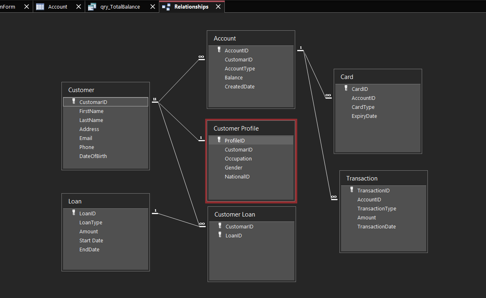

# Banking System (Microsoft Access)

A relational banking database built in Microsoft Access with tables, queries, forms, reports, and macros.

## Features

- 7 core tables: Customer, Customer Profile, Account, Card, Transaction, Loan, Customer Loan
- One-to-one, one-to-many, and many-to-many relationships (Customer Loan is a junction table)
- Queries: append, update, delete, and totals
- Reports, including account balances by account type and customers by city
- Forms and macros to add, edit, and delete records
- Main menu form with 4 buttons: Account, Customer, Loan, Card

## Tech Stack

Microsoft Access, SQL

## Screenshots

### Table Relationships

### Main Menu

### Total Balance by Account Type

## Author

Nourhan Mohamed
